# Architecture — USTA Edge Delivery Platform

| | |
|---|---|
| **Audience** | Developers and AI coding agents who build on this codebase. |
| **Last updated** | 2026-10-16 |
| **What this covers** | The parts of the platform and how they connect (§1), where things live in the code (§2), the constraints every change works within (§3), the planned repoless setup (§4), and pointers for martech (§5) and branching (§6). |
| **Companions** | Step-by-step runtime and delivery flows: [flow.md](flow.md). Requirements and status: [PRD.md](PRD.md). Decisions: [decision.md](decision.md). Martech: [MARTECH.md](MARTECH.md). Branching: [BRANCHING.md](BRANCHING.md). Diagrams: [`assets/`](assets/). Nothing here overrides [AGENTS.md](../AGENTS.md). |

---

## 1. Current site

One codebase renders the sites on [AEM Edge Delivery Services](https://www.aem.live/). Content is authored in DA
(da.live) and served by aem.live; the code (blocks, scripts, styles) decorates it in the visitor's browser. It is a
lift-and-shift of the existing sites (D-006).

| Part | What it does | Code / docs |
|---|---|---|
| **Visitor's browser** | Loads the page HTML, then runs `aem.js` + `scripts.js` in three phases: eager (first section, LCP), lazy (header, other sections, footer), delayed (third parties, 3 s later; D-039) | flow.md §1 |
| **aem.live / aem.page** | Edge Delivery: renders each DA document as HTML with `head.html`, serves the code that Code Sync pushed for each branch, serves sheets as JSON, and builds the query indexes on publish. `aem.page` = preview, `aem.live` = published. Its admin API (`api.aem.live`) lists a site's code branches for the Env selector panel | flow.md §5; PRD §4.8, R-A7 |
| **DA content** | Pages, the `/nav` and `/footer` fragments, `/fragments/…`, the block library `/.da/library/…`, the Env selector branches `/.da/environments/config`, and the per-site `/configs/site-config` sheet | flow.md §5; PRD §4.3 |
| **Authors and martech admins** | Edit and publish content in DA; martech admins alone can edit the config sheet (D-049) | flow.md §2, §5 |
| **Code repository + AEM Code Sync** | Every pushed branch becomes a preview host `https://{branch}--<site>--<org>.aem.page/`; `main` is production | flow.md §7; [BRANCHING.md](BRANCHING.md) |
| **Importer tools** | `tools/importer` and `tools/assets` turn source-site pages into DA documents; upload to DA only on request | flow.md §6; PRD §4.4 |
| **Page decoration** | `scripts/aem.js` (vendored, never edited) + `scripts/scripts.js` (`loadPage()`, `decorateMain()`, link targets, buttons, section metadata) | flow.md §1; PRD §9 |
| **Blocks and templates** | `blocks/<name>/` (one base block plus variants, D-023) and `templates/news/` (news CSS + the Related Articles feed) | PRD §4.2, R-T3; flow.md §4 |
| **Header and footer** | `blocks/header` and `blocks/footer`, built from the `/nav` and `/footer` fragments; the header also builds the breadcrumb from `/query-index.json` | PRD §4.7; flow.md §4 |
| **Martech loader** | `scripts/site-config.js` reads the config sheet (one tab per phase, D-015); `scripts/martech/loader.js` injects vendor scripts and modules after the consent gate (`scripts/consent-check.js`) | [MARTECH.md](MARTECH.md); flow.md §2 |
| **Donations** | `scripts/donate.js` and `blocks/donate-embed` load the Fundraise Up widget (overlay and inline form) | flow.md §3; PRD §4.5 |
| **Third parties** | Adobe Tags (Analytics), Hotjar, Adobe Target (pages with `Target` metadata), Fundraise Up, YouTube, Instagram; planned: OneTrust, a data layer | PRD §4.6, §10 |

---

## 2. Code layout

| Path | What lives there |
|---|---|
| `blocks/<name>/` | One folder per block: `<name>.js` (default export `decorate(block)`) and `<name>.css`, scoped to the block |
| `templates/news/` | The only page template: `news.css`, `news.js` (Related Articles), `news-sort.js`, `RELATED-ARTICLES.md` |
| `scripts/aem.js` | Vendored Edge Delivery library. **Never modify** (N2) |
| `scripts/scripts.js` | Page loading and global decoration: `loadPage()`, `loadEager()`, `loadLazy()`, `loadDelayed()` |
| `scripts/site-config.js` | Reads `/configs/site-config` tabs; `isConsentRequired()` |
| `scripts/martech/` | `loader.js` (`runPhase()`) and vendor modules (`hotjar.js`, `target.js` + `target-a4t.js`; at.js and VisitorAPI in `vendor/`) |
| `scripts/consent-check.js`, `scripts/consented.js` | Placeholder consent gate (to be replaced by OneTrust) |
| `scripts/donate.js` | Fundraise Up loader and donate-link rewrite |
| `styles/` | `styles.css` (critical: tokens, grid, sections, default content), `lazy-styles.css`, `fonts.css`, `foundation-buttons.css`, `usta-buttons.css` |
| `fonts/`, `icons/` | Self-hosted fonts; UI glyph SVGs (`icons/usta-buttons-icons/` for USTA buttons) |
| `head.html`, `404.html` | Page head (CSP, script includes; **never modify**, N2) and the error page |
| `helix-query.yaml` | Query index definitions (`/query-index.json`, `/news-index.json`) |
| `tools/importer/`, `tools/assets/` | Importers, parsers, transformers, backups, reports; image and document localizers |
| `tools/quality/`, `tests/a11y/` | Breakpoint, overflow, typography and SVG checks; site audits; axe accessibility tests |
| `tools/plugins/buttons/`, `tools/plugins/env-selector/`, `tools/da-library-preview/` | DA Buttons panel; DA Env selector panel (reopens the open page with other content and/or another code branch, PRD R-A7); block-library preview cleanup (all loaded by DA or the site, so they must stay served) |
| `skills/` | Project best-practice guides for agents (start at `skills/README.md`) |
| `docs/` | This file, [PRD.md](PRD.md), [decision.md](decision.md), [flow.md](flow.md), [BRANCHING.md](BRANCHING.md), [MARTECH.md](MARTECH.md); diagrams in `assets/` |

There is no build step and no `scripts/delayed.js`: delayed work lives in `loadDelayed()` in `scripts/scripts.js` (PRD §9).

---

## 3. Constraints every change works within

| Constraint | Why | Source |
|---|---|---|
| No build step, no runtime dependencies, no frameworks; native ES modules with `.js` imports | Edge Delivery serves the files as they are | PRD N1; D-010 |
| `scripts/aem.js`, `head.html`, `package-lock.json`, `node_modules/` are never modified | Vendored or platform-owned | PRD N2 |
| CSP with `'strict-dynamic'` and Trusted Types: only the nonce'd modules and the scripts they create run | Third-party scripts must be injected from code (the martech loader), never inline | PRD N10 |
| Three-phase loading; third parties only in the delayed phase (except `donate-embed`, and Adobe Target in the eager phase on pages with `Target` metadata) | PageSpeed target 100 | PRD N4; D-039, D-045 |
| Configuration is data in the per-site DA sheet, not code; no environment logic in code | Each environment is its own DA site | D-015, D-048; PRD R-M2 |
| Mobile-first `min-width` breakpoints 768 / 992 / 1200; one shared grid; the source's type scale | Lift-and-shift parity | D-007; PRD §5 |
| Files not listed in `.hlxignore` are served by Code Sync | Dev tooling must be excluded | PRD N11 |

---

## 4. Planned: repoless setup

- **One codebase, two sites** (D-012). The Foundation site (`ustafoundation.com`) is first and canonical; USTA.com follows.
  Both run the same code through Code Sync ([aem.live: repoless](https://www.aem.live/docs/repoless)).
- **Per site:** its own DA content (`<name>-dev` for dev, `<name>-com` for prod), its own `/configs/site-config` sheet with
  its own vendors and consent setting (R-M2, D-047), its own query-index definitions (TBD, R-Q1) and its own Buttons
  plugin registration in DA (R-A3). Adding a site or an environment follows PRD R-E1.
- **Akamai** fronts both production domains (planned; owner and cutover: PRD §12 Q11).
- **Shared profile:** undecided, so none is drawn (PRD §12 Q5).
- **Not yet site-aware in code:** `INTERNAL_HOSTS` in `scripts/scripts.js`, the Fundraise Up account in `scripts/donate.js`
  and the breadcrumb Home link to `/en/home` are Foundation-only, and UI strings are hard-coded in English. They must move
  to per-site config or content before USTA.com goes live (PRD §11, N7).
- **Status:** only the Foundation dev site has content (PRD §2).

---

## 5. Martech

Vendors are rows in the per-site config sheet, read per page-load phase and loaded by `scripts/martech/loader.js` after
the consent gate. The delayed phase is wired (Tags, Hotjar), and the eager phase on pages with `Target` metadata (Adobe
Target, Martech 3/4); Fundraise Up as a config row and OneTrust are planned (D-069). Detail: [MARTECH.md](MARTECH.md), flow.md §2, PRD §4.6.

---

## 6. Branching and release

`feature/*` → `develop` (QE) → `uat` (business) → `main` (production), by pull request only (D-011). Today there is no
`uat` branch yet and Adobe code drops merge straight into `main` (PRD §8.1, §8.6). Detail: [BRANCHING.md](BRANCHING.md),
flow.md §7.

---

## Keep it current

Update this file in the same PR when a part, a host, a site or the code layout changes (a new top-level folder, a new
script under `scripts/`, a new vendor, a new site, the CDN in front). The diagrams live in [`assets/`](assets/); keep
their file names, because README, BRANCHING.md and MARTECH.md embed them. See AGENTS.md, The Project-Docs Rule.
