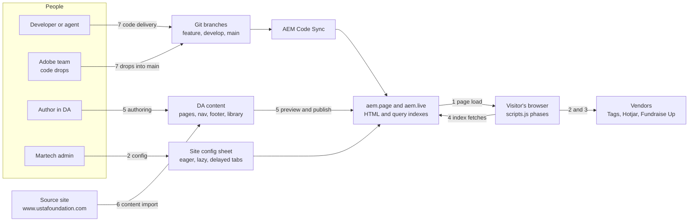
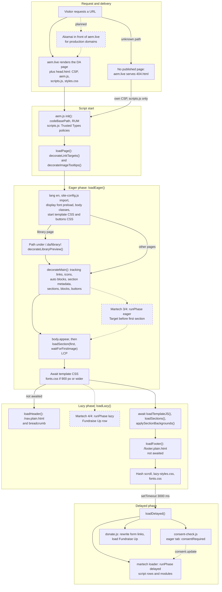
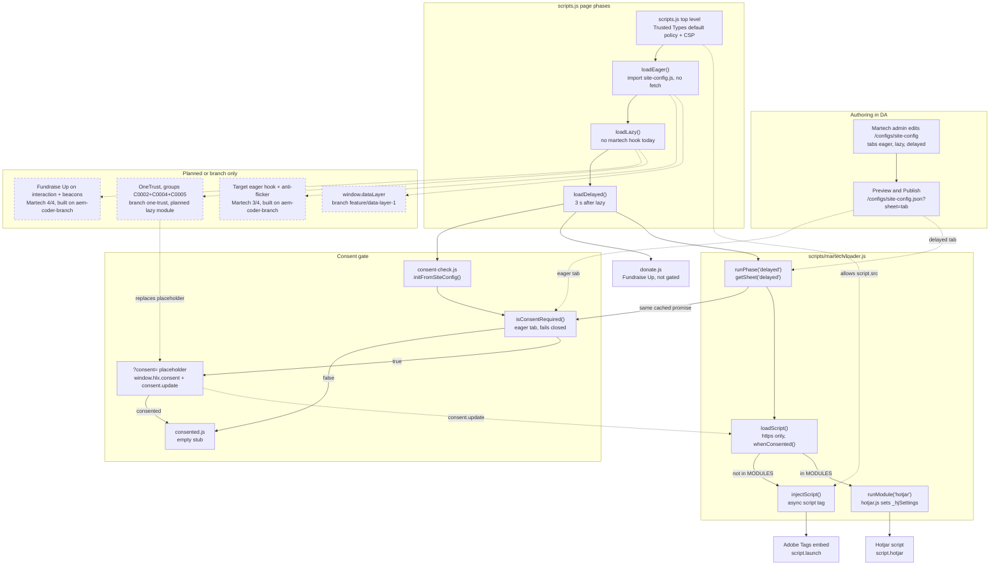
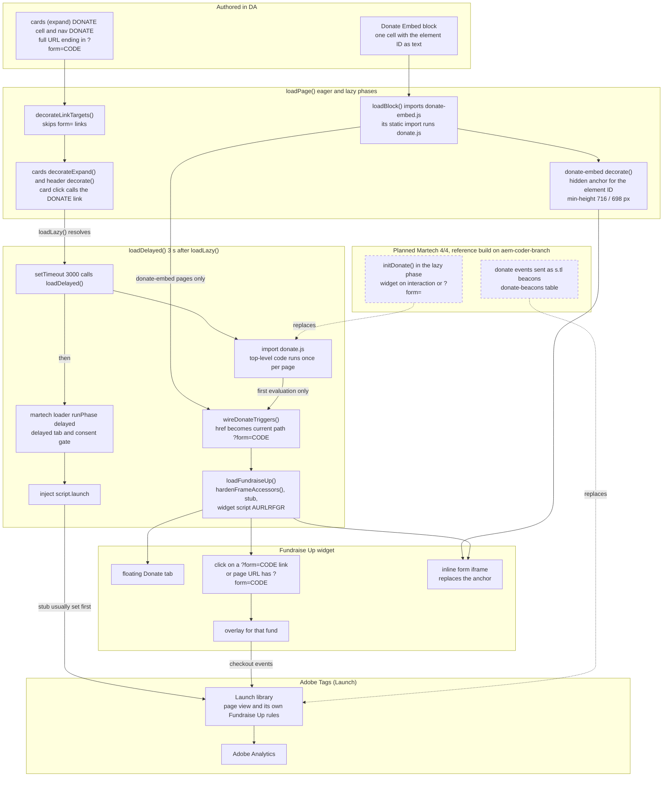
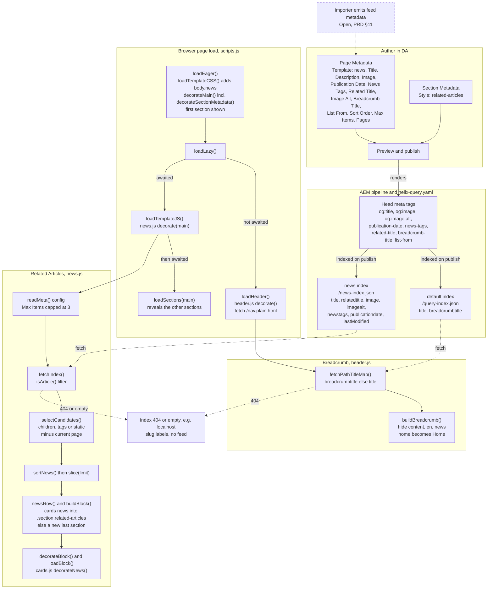
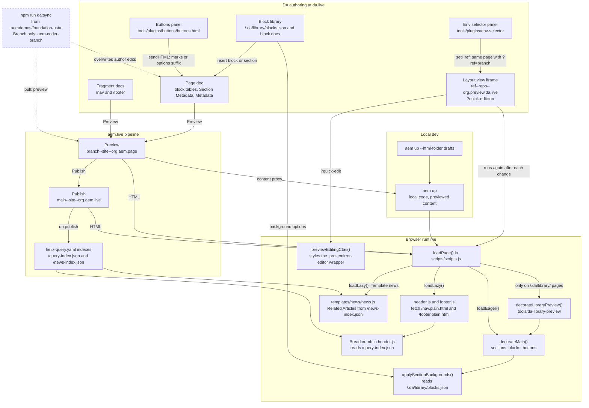
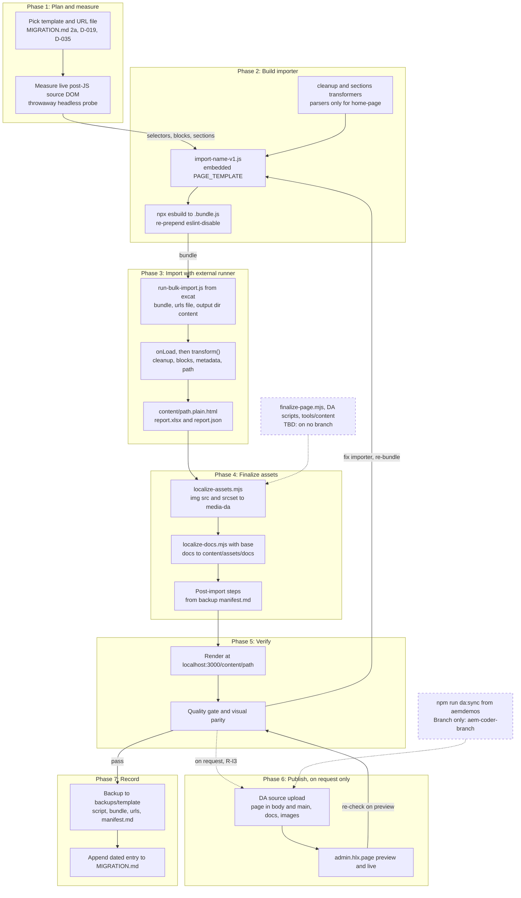
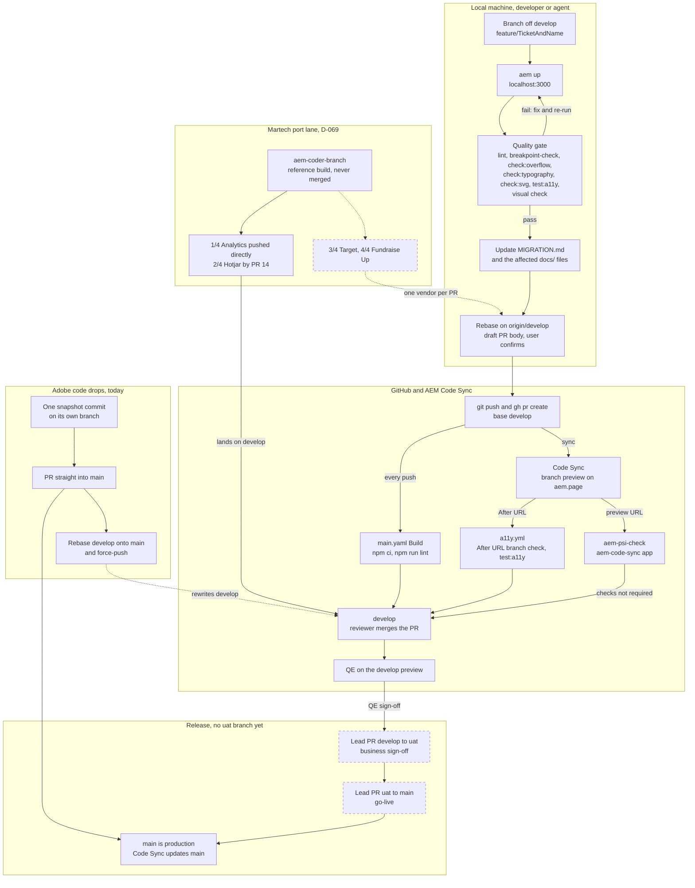

# Flows — USTA Edge Delivery Platform

| | |
|---|---|
| **Status** | v0.1, traced from the code on `develop` (working tree) on 2026-10-15 and checked step by step against it. |
| **Audience** | Developers and AI coding agents who build on this codebase. |
| **Last updated** | 2026-10-16 |
| **Companions** | [PRD.md](PRD.md) (requirements, `§x` / `R-x` / `Nx`, e.g. `§4.6`, `R-T1`, `N5`), [decision.md](decision.md) (`D-xxx`), [ARCHITECTURE.md](ARCHITECTURE.md) (parts and code layout), [MIGRATION.md](../MIGRATION.md) (build log). Nothing here overrides [AGENTS.md](../AGENTS.md). |
| **Conventions** | Each flow has a diagram, the steps in execution order with code references, the parts that are **Planned** or **Branch only** (dashed boxes in the diagrams), and the gotchas. Line numbers are as of the *Last updated* date; the function names are the stable anchor. Diagrams are Mermaid: GitHub renders them; VS Code needs a Mermaid preview extension. |

> **Keep it current.** When a change alters the order or the inputs of a flow (a new phase hook, a new sheet tab, a new
> metadata key, a new release lane), update the flow here in the same PR and log it in MIGRATION.md (AGENTS.md, The Project-Docs Rule).

## Index

| # | Flow | Runs when | Main code |
|---|---|---|---|
| 0 | [System map](#0-system-map) | — | — |
| 1 | [Page request and page load](#1-page-request-and-page-load) | Every page view, 404 included | `head.html`, `scripts/aem.js`, `scripts/scripts.js` |
| 2 | [Martech and consent](#2-martech-and-consent) | Every page view (delayed phase); when an admin edits the sheet | `scripts/site-config.js`, `scripts/martech/`, `scripts/consent-check.js` |
| 3 | [Donations (Fundraise Up)](#3-donations-fundraise-up) | Pages with `?form=` links or a `donate-embed` block (the widget loads on every page) | `scripts/donate.js`, `blocks/donate-embed/`, `blocks/cards/` |
| 4 | [News data: breadcrumb and Related Articles](#4-news-data-breadcrumb-and-related-articles) | On publish (indexes); every page load (breadcrumb); news pages (feed) | `helix-query.yaml`, `blocks/header/header.js`, `templates/news/` |
| 5 | [Authoring and publishing](#5-authoring-and-publishing) | An author edits, previews or publishes in DA | DA, `tools/plugins/buttons/`, `tools/da-library-preview/` |
| 6 | [Content import](#6-content-import) | A page or template is migrated from the source site | `tools/importer/`, `tools/assets/` |
| 7 | [Code delivery and release](#7-code-delivery-and-release) | A code change goes from a laptop to production | `docs/BRANCHING.md`, `PR_AGENT.md`, `.github/workflows/` |

---

## 0. System map

How the seven flows connect. Numbers on the arrows are the flow sections below.

---

## 1. Page request and page load

aem.live serves the page HTML with `head.html`; `scripts/aem.js` and `scripts/scripts.js` then decorate it in three
phases: **eager** (up to the first section and LCP), **lazy** (header, the other sections, footer) and **delayed**
(third parties, 3 s later). Governed by PRD §6 N4, §9 and D-039.

**Steps**

1. **Render.** aem.live renders the published DA document and adds `head.html`. Page metadata becomes `<meta>` tags with
   lower-case, hyphenated names (`template`, `theme`). `<body>` holds an empty `<header>`, a `<main>` with one `
`
   per section, and an empty `<footer>`; blocks are `
`, Section Metadata is
   `div.section-metadata`. — `head.html:1-9`
2. **CSP.** `head.html` sends the CSP (`move-to-http-header`). `script-src 'nonce-aem' 'strict-dynamic'` lets only the two
   nonce'd modules (`aem.js`, `scripts.js`) and the scripts they create run; `require-trusted-types-for 'script'` turns on
   Trusted Types. aem.live replaces the `aem` nonce placeholder with a random value (PRD N10). — `head.html:1-8`
3. **Critical CSS.** `styles/styles.css` is the only render-blocking stylesheet and has no `@import` (D-043). `body` stays
   `display: none` until it gets `appear`; header and footer stay hidden until their block status is `loaded`.
   — `styles/styles.css:111-146`
4. **Boot.** `aem.js` `init()` sets `window.hlx.codeBasePath` and starts RUM (1 view in 100 sends a `top` ping to `/.rum`).
   At its top level `scripts.js` creates the Trusted Types policies `tt-inner` and `default` (removes `srcdoc`, strips
   `<script>` from `createContextualFragment` / `document.write`, passes scripts and script URLs through; PRD §11
   security risk). — `scripts/aem.js:14-186`; `scripts/scripts.js:20-43`
5. **`loadPage()` starts.** `decorateLinkTargets()` applies the link-target rules to every `main a[href]` now and to later
   links through one capture-phase click listener: `#_blank` forces a new tab, external hosts and files open in a new
   tab, and `#`, `javascript:`, `mailto:`, `tel:`, `?form=` and links with a target are skipped (D-016).
   `decorateImageTooltips()` adds one delegated `mouseover` listener that copies `alt` to `title` (D-064).
   — `scripts/scripts.js:997-1065`
6. **`loadEager()` setup.** Sets `<html lang="en">`; imports `site-config.js` (defines `getSheet` / `isConsentRequired`,
   sets `window.hlx.siteConfig`, fetches nothing yet, D-015); calls `preloadDisplayFont()` (preload + inline
   `@font-face`, `font-display: block`, D-031). — `scripts/scripts.js:52-73, 899-902`
7. **Template and theme.** Adds body classes from `template` / `theme`, also through `getMetadataNormalized()` because DA
   preview and the dev server keep the author's casing. Starts `loadTemplateCSS()` (only `news` exists; a missing file is
   ignored) and `styles/foundation-buttons.css`, neither awaited (D-032, D-033, D-071). — `scripts/scripts.js:854-919`
8. **Block library pages.** Under `/.da/library/`, awaits `tools/da-library-preview/da-library-preview.js` and runs
   `decorateLibraryPreview(main)` before decoration (removes `library-metadata` and marker tables, frames each variant).
   — `scripts/scripts.js:922-927`
9. **`decorateMain()`**, in this order: `removeTrackingArtifacts()` (imported `about:` / `_hjSafeContext` links) →
   `decorateIcons()` (`span.icon` → `${codeBasePath}/icons/<name>.svg`, D-038) → `buildAutoBlocks()` (pasted EDS media
   links → `<picture>`, R-A5; `/fragments/` links inlined, not awaited; `/widgets/` links → `widget`) →
   `decorateSectionMetadata()` (`style` → section classes, other keys → `data-*`; aem.js does not do this) →
   `decorateSections()` (wrappers, each section hidden) → `decorateBlocks()` (`data-block-name` from the first class, so
   every variant loads the base block, D-023) → `decorateButtons()` (whole-paragraph links → `.button` or `a.cta-button`;
   `usta-buttons.css` only on pages with a `cta-usta*` link; runs before any block JS, R-A1). — `scripts/scripts.js:822-830`
10. **Before the first section.** Awaits the buttons CSS only when the first section needs it. Starts
    `applySectionBackgrounds()` (fetches `/.da/library/blocks.json` once, and only if a section has `data-background`).
    — `scripts/scripts.js:929-931, 756-797`
11. **LCP.** Adds `body.appear` and awaits `loadSection(first section, waitForFirstImage)`: each block loads its CSS and
    JS, then the section waits for its first `` and is shown. Hero photos are CSS backgrounds with their own
    `fetchpriority=high` preload (D-070). — `scripts/scripts.js:932-933`; `scripts/aem.js:520-551, 617-648`
12. **Editing helpers.** At `loadPage()`'s first await, `previewEditingCtas()` runs with `?quick-edit` (DA Layout view,
    R-A2) and `loadDa()` imports `da.live/scripts/dapreview.js` with `?dapreview`. — `scripts/scripts.js:655-728, 1074-1081`
13. **End of eager.** Awaits the template CSS, then `loadFonts()` loads `styles/fonts.css` when the viewport is at least
    900 px wide or `sessionStorage['fonts-loaded']` is set. — `scripts/scripts.js:78-85, 935-944`
14. **`loadLazy()`: header.** Starts `loadHeader()` without awaiting it: `header.js` fetches `/nav.plain.html`, builds the
    nav, awaits `buildBreadcrumb()` (flow 4), then appends the nav (R-H1–R-H3). — `scripts/scripts.js:951-952`;
    `blocks/header/header.js:226-341`
15. **Template JS and sections.** Awaits `loadTemplateJS()` (on news pages: the Related Articles feed, flow 4), then awaits
    `loadSections(main)` (each remaining section in order; RUM enhancer on sampled views), then awaits
    `applySectionBackgrounds()` over the whole document (catches fragments and the feed). — `scripts/scripts.js:955-959`
16. **Footer and the rest.** Starts `loadFooter()` (`/footer.plain.html`, not awaited), scrolls to the URL hash once header
    and footer resolve, and starts `lazy-styles.css` and `loadFonts()`. — `scripts/scripts.js:961-978`
17. **Delayed phase.** When `loadLazy()` resolves, `setTimeout(loadDelayed, 3000)` (D-039). `loadDelayed()` starts three
    imports and awaits none: `consent-check.js`, `donate.js`, then `martech/loader.js` + `runPhase('delayed')` (flows 2
    and 3). — `scripts/scripts.js:985-992, 1066-1071`
18. **404.** With no published page, aem.live serves `404.html`: no `head.html`, its own laxer CSP (no `frame-src`, no
    Trusted Types, N10), `scripts.js` only, a `404` RUM checkpoint. The same `loadPage()` runs; a Go back button is added
    for a same-origin referrer. The `hero (error)` variant is not wired in yet (T7). — `404.html:1-71`

**Planned and branch only**

- **Martech 3/4 (Planned):** an eager `runPhase('eager')` hook for Adobe Target before the first section, with the
  anti-flicker wait (D-045, D-052). Reference build on `aem-coder-branch`, on the old config model (D-069).
- **Martech 4/4 (Planned):** a lazy `runPhase('lazy')` hook; Fundraise Up becomes a lazy-tab row (D-046). Today the lazy
  tab is never read.
- **Branch only `one-trust`:** imports `consent-check.js` at the top level of `scripts.js`; must be reworked into a
  `scripts/martech/` module in the lazy tab (D-060, D-066).
- **Branch only `feature/data-layer-1`:** `initDataLayer()` creates `window.dataLayer` at the start of `loadEager()` (D-057).
- **Branch only `feature/eds-125`:** a second loader, `loadConfiguredScripts()`, called in all three phases (PRD §12 Q26).
- **Planned:** Akamai in front of the production domains (D-012); `404.html` to match the source (T7).

**Gotchas**

- `loadEager()` awaits the template CSS after the first section, so the lazy phase starts only once it loads or fails.
- On news pages `loadTemplateJS()` is awaited before `loadSections()`: every section after the first stays hidden until
  `/news-index.json` and the cards block have loaded (`scripts/scripts.js:955-956`).
- The 3 s timer starts when `loadLazy()` resolves (all sections + template JS), not after the header and footer.
- Nav and footer content never goes through `decorateMain()`: no icons, auto-blocks, section metadata or buttons, and
  their links get targets only at click time.
- The header stays hidden until `/nav.plain.html` and `/query-index.json` are both fetched (the breadcrumb is awaited
  first; the site root skips the index). On localhost the index 404s and crumbs fall back to slug labels.
- Fragment auto-blocks are not awaited: a fragment usually lands inside the host section's `default-content-wrapper`, and
  a slow one can miss the lazy `applySectionBackgrounds()` pass.
- Read page metadata with `getMetadataNormalized()` (`templates/news/news.js` has its own `readMeta()`); `aem.js`
  `getMetadata()` is case-sensitive.
- Any `Template` value requests `templates/<name>/<name>.css` and `.js`; use `Theme` for CSS-only page types (D-033).
- `INTERNAL_HOSTS` hard-codes the Foundation production host and one preview pattern, so absolute links to any other host
  of this codebase open in a new tab (PRD §11).
- The 900 px check for eager `fonts.css` is in JS and is not a project breakpoint (D-007).
- There is no `scripts/delayed.js`; delayed work lives in `loadDelayed()` (PRD §9). `head.html` and `aem.js` are
  untouchable (N2), so load-order changes go in `scripts.js`.
- `404.html` has a laxer CSP, so third-party behaviour (e.g. Fundraise Up frames) can differ there; test on a content page.
- There is no `widgets/` folder and `widget.js` does not check `resp.ok`, so a `/widgets/` link fills the block with a 404
  body and only logs the error.

*Related:* D-007, D-010, D-015, D-016, D-023, D-024, D-031, D-032, D-033, D-038, D-039, D-043, D-064, D-070, D-071;
PRD §4.3, §4.7, §6 N2/N4/N10, §9; [aem.live: CSP](https://www.aem.live/docs/csp),
[Keeping it 100](https://www.aem.live/developer/keeping-it-100).

---

## 2. Martech and consent

Decides which vendor scripts load, in which phase, and whether they wait for consent. The input is the per-site
`/configs/site-config` DA sheet (one tab per phase, D-015; an authored sheet, D-048). Detail:
[docs/MARTECH.md](MARTECH.md); requirements: PRD §4.6.

**Steps**

1. **Edit (authoring).** A martech admin edits `key | value` rows in the tab of the phase that uses them: `eager`
   (`consentRequired`), `lazy` (planned: Fundraise Up, OneTrust), `delayed` (`script.launch`, `script.hotjar`). Each DA
   site has its own sheet, so the code has no environment logic (D-012, R-M2). — `docs/MARTECH.md:22-50`
2. **Permissions.** DA org permission rows let only martech admins write the sheet (exact path
   `/<site>/configs/site-config.json` or folder rule `/<site>/configs/+**`; the longest rule wins, so other authors need a
   read row; D-049, R-M4). — `docs/MARTECH.md:52-56`
3. **Preview and publish.** Preview updates aem.page and localhost; Publish updates aem.live. Each tab is served as JSON at
   `/configs/site-config.json?sheet=<tab>`. A new site needs all three tabs, `consentRequired` set on purpose and the
   permission rows (R-E1). — `docs/MARTECH.md:58-61`; `scripts/site-config.js:16, 55`
4. **Trust chain.** The CSP allows only nonce'd scripts and the scripts they create (`'strict-dynamic'`), and the
   pass-through `createScriptURL` in the `default` Trusted Types policy is what lets the loader set `script.src`.
   — `scripts/scripts.js:20-43`; `head.html:1-8`
5. **Phases.** `loadEager()` imports `site-config.js` (no fetch); `loadLazy()` has no martech hook yet (the lazy tab is
   never read); `loadDelayed()`, 3 s after lazy, starts `consent-check.js`, `donate.js` (not consent-gated) and
   `martech/loader.js` + `runPhase('delayed')`, none awaited. The loader comes after `donate.js` so the interim Launch
   library's Fundraise Up rules see the stub (`7e3c377`); this is not enforced, but holds in practice because the loader
   waits for sheet fetches first. — `scripts/scripts.js:899-901, 951-992`
6. **Consent requirement.** `consent-check.js` runs `initFromSiteConfig()` → `isConsentRequired()`, which fetches the
   `eager` tab once (cached promise). A missing row, any value other than `true`/`false`, or a failed fetch warns and
   counts as **required** (D-067, R-M1). — `scripts/site-config.js:32-44, 53-87`; `scripts/consent-check.js:54-65`
7. **Not required.** With `consentRequired=false`, `consented.js` (an empty stub) is imported, no `consent.update` fires
   and `window.hlx.consent` stays unset. ustafoundation is meant to use this (D-047). — `scripts/consent-check.js:28-32, 57-60`
8. **Required (placeholder gate).** With `true`, `?consent=accept|true|1|yes` grants consent and anything else declines.
   It sets `window.hlx.consent = { consented }`, dispatches `consent.update` and, on consent, imports `consented.js`.
   OneTrust will replace this (PRD §11). — `scripts/consent-check.js:16-23, 38-47, 62`
9. **`runPhase('delayed')`.** Runs once per phase and never rejects. It reads the delayed tab, splits it into
   `script.<name>` rows and `<module>.enabled` rows, and returns early when there are none. — `scripts/martech/loader.js:144-174`
10. **Script rows.** It awaits `isConsentRequired()` (same cached promise, one fetch), then calls `loadScript()` per row
    without awaiting. `loadScript()` accepts only `https:` URLs and, when consent is required, waits in
    `whenConsented()` (resolves at once if `window.hlx.consent.consented`, else on a `consent.update` with
    `consented: true`). — `scripts/martech/loader.js:42-53, 104-116, 155-157`
11. **Plain scripts.** A name not in `MODULES` goes to `injectScript()`: one async `<script>` in `<head>` (skipped if the
    same `src` exists). `script.launch` takes this path; the Tags library then sends the Analytics page view (D-044).
    — `scripts/martech/loader.js:59-65, 117-121`
12. **Modules.** A name in `MODULES` (today only `hotjar`) runs `scripts/martech/<name>.js` with its `<name>.*` settings
    and a `ctx` (`consentRequired`, `whenConsented`, `injectScript`, `warn`); a thrown error is one warning and never
    stops other vendors (D-068, R-M5). `hotjar.js` checks the URL form, skips if Hotjar is already on the page, sets
    `_hjSettings` and the `hj()` queue, then injects the script. — `scripts/martech/loader.js:33, 67-95`;
    `scripts/martech/hotjar.js:11-31`
13. **`<module>.enabled` rows.** `false` skips, other values warn, unknown names warn `unknown module`; the loader does
    **not** wait for consent on this path, so the module must use `ctx`. The phase resolves when every module settles.
    develop has no such row yet. — `scripts/martech/loader.js:124-142, 158`

**Planned and branch only**

- **Martech 3/4 — Target (Planned; reference build on `aem-coder-branch`):** eager hook, `target.enabled` row, a
  `scripts/martech/target.js` module; at.js 2.11.4 only on pages with `Target` metadata; the first section waits for
  offers up to `target.flickerTimeout` (1000 ms); with consent required, Target starts after consent and does not hold
  first paint; A4T client mode (D-045, D-052). `getSheet(name, priority)` already accepts a fetch priority for this.
- **Martech 4/4 — Fundraise Up (Planned; reference build on `aem-coder-branch`):** a lazy-tab row; the widget loads on
  first deliberate interaction or with `?form=`; donation beacons are sent from code (D-046; flow 3).
- **OneTrust (Branch only `one-trust`):** Consent Mode v2 defaults denied; the OneTrust stub from `onetrust.*` settings;
  a vendor is granted only when all its groups are in `OnetrustActiveGroups` (Analytics, Hotjar, Target: C0002 + C0004 +
  C0005, D-066); no `OtAutoBlock.js` (D-060). It still reads the old `/site-config.json`, sets no `window.hlx.consent`,
  uses the removed `hotjar-router.js` and forces `consentRequired: true` (TEMP); it must become a lazy-tab module.
- **Data layer (Branch only `feature/data-layer-1`):** `window.dataLayer` created first in `loadEager()`; GTM and a Meta
  Pixel are planned consumers (D-057, R-M6).
- **Tests and permissions (Planned):** `tools/martech-tests/` (on `aem-coder-branch`) must be rewritten for the per-tab
  sheet (R-M3); permission rows for the new `/configs/` path are TBD (R-M4).

**Gotchas**

- `consentRequired` fails closed: with no row or a typo, Tags and Hotjar wait for consent, and the placeholder never grants
  it for real visitors. The ustafoundation eager tab must say `false` (D-047, D-067).
- `ctx.whenConsented()` never resolves when `consentRequired=false` (no event fires): a module must check
  `ctx.consentRequired` first.
- A declined `consent.update` does not end the wait, and the placeholder fires only once per page, so after a decline
  nothing gated loads for that page view.
- Consent and loader start in parallel; new code must read `window.hlx.consent` before adding a `consent.update`
  listener, as `whenConsented()` does.
- `consent-check.js` fetches the eager tab on every page, even when the delayed tab lists nothing.
- Only `script.<name>` rows are consent-gated by the loader. Do not add a `hotjar.enabled` row: `hotjar.js` would run
  without a `url` and only warn.
- Keep all three tabs: with one tab, Edge Delivery serves it as `default` and `?sheet=` stops working.
- A new module needs its name in `MODULES` (`scripts/martech/loader.js:33`); modules never import each other or
  `consent-check.js` (whose body starts the consent workflow).
- The sheet is public JSON: never put secrets in it (R-M5).
- Every code branch previewed on a DA site reads that site's one sheet: change a row format only when the PR that reads
  it merges, and list the row changes in the PR (PRD §11).
- Tightening the Trusted Types `createScriptURL` pass-through breaks the loader (PRD §11 security risk).
- USTA's interim production Tags library still has Target and a Hotjar rule: keep `script.hotjar` out of the production
  delayed tab until that rule is removed, or Hotjar loads twice (D-044).
- Hotjar starts only over HTTPS and refuses headless browsers: test on a branch preview with a normal user agent.
- Fundraise Up, Instagram's `embed.js`, the homepage YouTube player and `video-embed` without Row 2 load outside the
  consent gate (D-021, PRD §11, §12 Q9).
- An Adobe code drop can replace `scripts.js`, `consent-check.js`, `consented.js` and `donate.js` wholesale: run the
  checks in docs/MARTECH.md "After an Adobe code drop" (PRD §8.6).

*Related:* D-012, D-015, D-021, D-039, D-040, D-044–D-049, D-052, D-057, D-060, D-066–D-069; PRD §4.6 (R-M1–R-M6), §8.3
R-E1, §11, §12 Q9; `docs/assets/martech.svg`.

---

## 3. Donations (Fundraise Up)

Two paths reach a Fundraise Up donation: the **overlay** (a `?form=<CODE>` link or URL; the widget loads in the delayed
phase on every page) and the **inline form** (the `donate-embed` block, which loads the widget as soon as the block loads).
Requirements: PRD §4.5.

**Steps — overlay**

1. **Author.** Each fund's DONATE (4th cell of a `cards (expand)` row) and the nav DONATE are full, path-bearing URLs
   ending in `?form=<CODE>`, because DA publishing turns a query-only href into `/` (D-025, R-D1).
   — `blocks/cards/cards.js:12-25`
2. **Link targets.** `decorateLinkTarget()` skips every `[?&]form=` href, so donate links open in the same tab (D-016).
   — `scripts/scripts.js:1013-1021`
3. **Cards and nav.** `decorateExpand()` moves the 4th cell into `.cards-expand-donate`; a click anywhere on the card
   that is not a link calls `donateLink.click()`. `header.js` marks the first `.nav-tools` link as `nav-donate`; its
   authored href stays until `donate.js` rewrites it. — `blocks/cards/cards.js:59-87`; `blocks/header/header.js:295-300`
4. **Timing.** `loadDelayed()` runs 3 s after `loadLazy()` and imports `donate.js` (not consent-gated, D-039).
   — `scripts/scripts.js:985-992, 1066-1071`
5. **Rewrite.** `donate.js` evaluates once per page: `wireDonateTriggers()` scans every `a[href*="form="]` once and sets
   the href to `<current path>?form=<CODE>`. — `scripts/donate.js:148-161`
6. **Widget load.** `loadFundraiseUp()` returns if `window.FundraiseUp` exists; otherwise it patches the iframe
   `contentWindow` / `contentDocument` getters so Fundraise Up's nested frames get a pass-through Trusted Types policy
   (`hardenFrameAccessors()`), builds the queueing stub and inserts `cdn.fundraiseup.com/widget/AURLRFGR`.
   — `scripts/donate.js:19, 41-133, 164`
7. **Overlay.** The widget renders the floating Donate tab and intercepts clicks on `?form=<CODE>` links to open that
   fund's overlay. With `?form=<CODE>` in the page URL, the widget opens it once loaded; no site code reads the
   parameter. — `scripts/donate.js:1-8`

**Steps — inline form**

8. **Author.** A `Donate Embed` block with one cell: the element ID as plain text (e.g. `XJYDXZPC`), because publishing
   strips fragment-only `#ID` hrefs (D-040, R-D2). Only `import-chris-evert-v1` emits it (in a `split-even` section).
   — `blocks/donate-embed/donate-embed.js:16-20`
9. **Module load.** When the block's section loads, `donate-embed.js` is imported; its static import of `donate.js` runs
   `wireDonateTriggers()` and `loadFundraiseUp()` right then, not in the delayed phase (~384 ms instead of ~3.2 s).
   — `blocks/donate-embed/donate-embed.js:23`
10. **Placeholder.** `decorate()` takes the ID (from a surviving `#` link or the text), empties the block and adds a
    visually hidden `<a href="#<ID>">` (not `display: none`: the widget must find it). The CSS reserves 716 px (698 px
    from 768) to avoid layout shift. — `blocks/donate-embed/donate-embed.js:26-64`; `donate-embed.css:9-62`
11. **Hydration.** The widget replaces the anchor with the live form iframe in the top page — no host iframe, so the
    `frame-ancestors 'none'` problem from D-013 does not apply. The later delayed import reuses the cached module.

**Steps — analytics today**

12. The loader injects `script.launch` (after the consent gate, flow 2). The interim Launch library sends the page view
    and has its own Fundraise Up rules, which attach only if the `window.FundraiseUp` stub exists when it runs; site code
    on develop sends no donation beacons. — `scripts/scripts.js:988-990`; `7e3c377`

**Planned and branch only** (Martech 4/4, D-046, D-069; reference build on `aem-coder-branch`, ported by PR)

- `loadLazy()` imports `donate.js` early and calls `initDonate()`: links are rewritten at once and again at click time.
- The widget loads on the first `pointerdown` / `keydown` / `touchstart` / `wheel` / `scroll`, or at once with `?form=`
  (std mobile 67 → 96, Best Practices 61 → 100 on localhost); `donate-embed` still loads at once.
- `checkoutOpen` / `donationComplete` become `s.tl` beacons from the sheet's `donate-beacons` table; on
  `feature/data-layer-1` they are also pushed to `window.dataLayer` (D-057).
- P1: security review of the Trusted Types relaxation; P2: move the hard-coded account `AURLRFGR` to config (PRD §11).

**Gotchas**

- **Early clicks leave the site.** Until `donate.js` runs, donate links keep the authored absolute href; on a preview
  host a click goes to the production domain.
- On a `donate-embed` page `donate.js` runs once, at block load: links not yet in the DOM (a slow nav, the footer) are not
  rewritten (from the code; not browser-tested). On develop, links added after the single scan are never rewritten.
- Any link with a `form` query parameter, on any host, becomes a donate trigger and skips the new-tab rules; the rewrite
  drops the link's other query parameters and hash.
- The cards (expand) chevron toggles the card and its click also bubbles to the card listener, which opens the overlay.
- Query-only `?form=` and fragment-only `#ID` links work on localhost but break after DA publishing: test on a preview.
- Trusted Types are relaxed site-wide (pass-through `default` policy; the frame-getter patch applies to every iframe). A
  CSP or Fundraise Up change can break the tab or the form: re-test the Chris Evert page and a `?form=` overlay.
- The Launch donation rules depend on unenforced load order; Fundraise Up loads outside the consent gate.
- `AURLRFGR` is hard-coded, so every site on this code gets Foundation's Donate tab; which origins the account allows is
  open (PRD §12 Q24). The reserved form heights were measured on the live widget.

*Related:* D-013, D-016, D-025, D-039, D-040, D-046, D-047, D-057, D-061, D-067, D-069; PRD §4.5, §4.6, §6 N10, §11,
§12 Q24.

---

## 4. News data: breadcrumb and Related Articles

On publish, page metadata goes into two query indexes. On every page except the site root the header builds the
breadcrumb from `/query-index.json`; on `Template: news` pages the news template builds Related Articles from
`/news-index.json`. Both run in the lazy phase. Requirements: PRD R-H1, R-Q1, R-T3.

**Steps — publish**

1. **Author.** A news article (`/en/home/news/<slug>`) sets `Template: news` (only news uses `Template`; others use
   `Theme`, D-033; the listing has none, D-034). The same Metadata table holds the card data (Title, Description, Image,
   Publication Date, News Tags, Related Title, Image Alt, Breadcrumb Title) and the feed settings (List From, Sort Order,
   Max Items, Pages; D-041, D-042, D-056). The feed slot is a section holding only Section Metadata
   `Style: related-articles`. — `templates/news/news.js:17-23`
2. **Render.** EDS writes the rows as lower-case, hyphenated `<meta>` tags; Title → `og:title`, Image → `og:image`.
   `og:image:alt` comes from the Image Alt row, else from the first content image's alt — never from the Metadata Image.
3. **Index on publish.** `default` → `/query-index.json` (all pages except `/drafts/**`, `/nav`, `/footer`,
   `/**/fragments/**`; `title`, `breadcrumbtitle`, …). `news` → `/news-index.json` (`/**/news/**` minus the listing and
   drafts; `title`, `relatedtitle`, `image`, `imagealt`, `publicationdate`, `newstags`, `lastModified`).
   `lastModified` comes from the HTTP `Last-Modified` header (UNIX seconds). — `helix-query.yaml:12-96`

**Steps — page load**

4. **Eager.** `loadTemplateCSS()` adds `body.news` and loads `news.css`; `decorateSectionMetadata()` turns the slot into
   `.section.related-articles`; every section is hidden until loaded; only the first is shown. — `scripts/scripts.js:899-945`
5. **Lazy.** `loadHeader()` starts (not awaited), then `loadTemplateJS()` is awaited, then `loadSections()`: the
   breadcrumb and the feed run in parallel. — `scripts/scripts.js:951-956`
6. **Breadcrumb.** `header.js` fetches `/nav.plain.html` (if that fails, no breadcrumb); `buildBreadcrumb()` returns null at
   `/`; otherwise `fetchPathTitleMap()` maps each path to `breadcrumbtitle`, else `title` (empty map on error).
   — `blocks/header/header.js:26-61, 226-229`
7. **Trail.** Segments `content`, `en`, `news` are hidden, so an article reads "Home > {title}". `home` becomes one Home
   crumb linking to `/en/home` (plain text with `aria-current` when last). Ancestors use the index label, else
   `slugToLabel()`; the current crumb uses `breadcrumb-title` meta, else `document.title` (D-030).
   — `blocks/header/header.js:12, 74-121`
8. **Feed config.** `news.js` reads its settings with `readMeta()` (also matches raw casing). Defaults: `children`, `desc`,
   3; `MAX_LIMIT = 3` clamps Max Items to 1–3 (D-018). — `templates/news/news.js:9-26, 130-135`
9. **Fetch.** `fetchIndex()` loads `/news-index.json` and keeps article rows (`isArticle()`); on error or no rows the feed
   is skipped silently. — `templates/news/news.js:48-62, 137-138`
10. **Select.** `static`: the `Pages` paths in author order (unknown paths drop out). `tags`: rows sharing a `News Tags`
    leaf (empty tags → no cards). `children`: the whole index. The current page is always removed.
    — `templates/news/news.js:30-44, 65-78, 140-142`
11. **Sort and cap.** `sortNews()` by `Publication Date`, else `lastModified`; ties break on `lastModified` in the same
    direction; then `slice(0, limit)`. — `templates/news/news-sort.js:6-41`
12. **Build.** `newsRow()`: linked image (`Visit the <title> page` alt; `imagealt` as hover title, D-056), `h3` title
    (`Related Title`, else title), date (`Publication Date` as authored, else `lastModified`), description, "Read More".
    `buildBlock('cards', rows)` with class `news` goes into `.section.related-articles`, else a new last section, then
    `decorateBlock()` + `loadBlock()` → `cards.js` `decorateNews()`. — `templates/news/news.js:82-171`;
    `blocks/cards/cards.js:111-160`
13. **Reveal.** `loadSections()` shows the remaining sections (the cards block is already loaded); then the footer and the
    hash scroll, so `#related-articles` finds the heading. — `scripts/scripts.js:956-975`

**Planned and open**

- The news importer does not emit the feed metadata and still writes the sitemap lastmod as Publication Date; make it (or
  a post-import step reading the source `data-tags`) do so, verified on a live preview (PRD §11, §12 Q17).
- Related Articles parity: selection differs from the source, which shows 4 cards on 9 pages; the cap's approval is open
  (§12 Q16, D-018).
- How each repoless site gets these index definitions (R-Q1); hard-coded UI strings (N7); the breadcrumb Home link to
  `/en/home` is Foundation-only (PRD §11).

**Gotchas**

- `templates/news/RELATED-ARTICLES.md` (4 cards, decorative thumbnails) and `tools/quality/audit/related-articles-audit.mjs`
  (no cap) disagree with the code; MIGRATION.md 2026-09-22 describes an older tie-break and an empty-tags fallback. The
  code is the ground truth.
- On news pages every section after the first stays hidden until the index fetch and the cards block finish.
- `loadTemplateJS()` swallows errors from `news.js` without logging: a broken `news.js` shows no feed and no console error.
- `header.js` reads `breadcrumb-title` with case-sensitive `getMetadata()`; on raw `.plain.html` with `Breadcrumb Title`
  the override is missed. A page's Breadcrumb Title reaches child pages only through the index.
- Index data changes only on re-preview / re-publish; until then undated articles all tie on an empty `lastModified`.
- 60 articles have no Publication Date (D-042), so their cards show the index date and many share one date.
- Static mode needs exact index paths (`/en/home/news/<slug>`); a bare slug, full URL or typo drops out silently.
- A hidden segment (`news`, `en`, `content`) disappears anywhere in any trail; draft pages never reach either index.
- On localhost both indexes 404: slug labels, no feed (stub `/news-index.json` to test).
- After a re-import the page has no feed metadata and no `related-articles` section, keeps a static snapshot of the source
  cards, and `news.js` appends its feed in a new section — Related Articles shows twice.

*Related:* D-018, D-030, D-033, D-034, D-041, D-042, D-056; PRD R-T3, R-H1, R-Q1, N7, §11, §12 Q16, Q17;
[templates/news/RELATED-ARTICLES.md](../templates/news/RELATED-ARTICLES.md); VALIDATION.md §2.

---

## 5. Authoring and publishing

From an author's edit in DA (da.live) to a preview on aem.page and a live page on aem.live, plus the authoring tools that
run inside DA and the local preview. Requirements: PRD §4.2, §4.3, §4.8.

**Steps**

1. **Blocks.** A block is a table whose first row names the block and its variants, e.g. `Cards (expand)`; it renders as
   `
` and loads `blocks/cards/` (D-023, PRD §4.2). — `scripts/aem.js:520-577`
2. **Block library.** Authors insert blocks, variants and sections from `/.da/library/` (index sheet `blocks.json`, one doc
   per block). Library pages render through `tools/da-library-preview/`, which strips the library tables and labels each
   variant before decoration (PRD §4.3). — `scripts/scripts.js:924-927`; `tools/da-library-preview/da-library-preview.js`
3. **Sections.** A horizontal rule splits sections; a `Section Metadata` table's `Style` takes a comma list of composable
   styles (`center, narrow`, `section-yellow, center-intro`; D-024); other keys become `data-*` attributes
   (`profile-anchor`, D-028; `background`). — `scripts/scripts.js:738-754`
4. **Background options.** `background` may name an option from the `blocks.json` `options` tab (`name=#hex`) or a hex;
   `applySectionBackgrounds()` adds the option name as a section class, painted by a `main .section.<name>` rule.
   — `scripts/scripts.js:764-797`; `styles/styles.css:599-613`
5. **Buttons panel.** Registered once per DA site (`library` → `Buttons` = `/tools/plugins/buttons/buttons.html`, R-A3). It
   reads `/.da/library/buttons.json` through the DA SDK, pre-fills Update from the selection, rejects `javascript:` /
   `data:` / `//host` URLs, and inserts one `
`: Foundation styles as formatting marks, `usta-…` styles as a
   `style="…"` option (D-062), colours and icons in a trailing `[…]` (D-063), new tab as `#_blank`.
   — `tools/plugins/buttons/buttons.js:225-806`
6. **Metadata.** The page ends with a `Metadata` table: `Title`, `Description`, `Image`, `Image Alt`, `Template` (only
   `news`), `Theme` (`general`, `leadership`; body class only, D-033), `Breadcrumb Title`, `Related Title`, `Publication
   Date`, `News Tags`, and the news feed keys (R-T3).
7. **Homepage.** Edit both DA docs, `index` (served at `/`) and `en/home`; copy images by their published
   `…/en/home/media_<hash>` renditions (R-T2).
8. **Nav and footer.** Root docs `/nav` and `/footer`, previewed and published on their own; every page picks them up at
   runtime (R-H3). Links containing `/fragments/` are inlined by `buildAutoBlocks()`.
9. **Layout view.** Experience Workspace loads the page in an iframe with `?quick-edit=on` and re-runs `loadPage()` after
   each change; `previewEditingCtas()` styles the button being edited through the `.prosemirror-editor` wrapper only
   (R-A2). `?dapreview` loads da.live's preview script. — `scripts/scripts.js:644-728, 1077-1081`
10. **Preview.** The admin pipeline renders the doc on aem.page; a code branch shows the same content at
    `https://{branch}--foundation-dev--usta-digital.aem.page/{path}` (branch lowercased, `/` → `-`); Code Sync puts code
    on each branch host (PRD §8.3). — `README.md` (Environments)
11. **Runtime.** On aem.page / aem.live the browser runs flow 1 (link targets, decoration, buttons, first section; then
    header, template JS, sections, footer).
12. **Publish.** Publishes to aem.live. Publishing is outward-facing: agents publish only when asked (R-I3).
13. **Indexes.** Publish updates `/query-index.json` and `/news-index.json` (R-Q1), which feed the breadcrumb and Related
    Articles (flow 4).
14. **Local preview.** `aem up` serves code from the working copy and content from aem.page: a never-previewed page 404s,
    and so do the indexes (slug crumbs, no feed). Content not yet in DA goes in `drafts/` with `--html-folder drafts`;
    restart the CLI after adding a draft (PRD §7).
15. **Env selector.** The Environment panel lists the branches from the `code` tab of `/.da/environments/config`
    (`title` = text, `value` = branch; read with the SDK's `daFetch` from `admin.da.live`, falling back to the built-in
    `main`, `uat`, `develop`, D-078). The author picks one and selects Go. The panel rebuilds the open page's canvas URL from DA's context (`hash`, else `org` / `repo` / `path`), sets `ref` to the
    branch (added when the URL has none, which means `main`) and sends it with `setHref`, e.g.
    `/canvas?ref=uat#/usta-digital/foundation-dev/en/home`; DA reloads. The canvas then renders the preview and loads
    plugins from that branch (R-A7, D-077). Go is disabled while the current branch is selected. — `tools/plugins/env-selector/env-selector.js`

**Planned and branch only**

- **`da:sync` (Branch only `aem-coder-branch`, D-050, R-I10):** mirrors Adobe's DA `aemdemos/foundation-usta` into our DA:
  backup first, GET + POST per file (DA's copy API is same-org only), overwrite, never delete, `/.da/library` included,
  bulk preview, never publish; needs `DA_TOKEN` outside AEM Coder. TBD: bring it to develop and decide when syncing stops.
- **Planned (user-owned, outward-facing):** USTA buttons in the Layout view and `/.da/library/buttons` USTA rows (untested
  without a signed-in DA session); delete `blocks/library-metadata/` once confirmed in Experience Workspace.
- **TBD:** confirm the `background` option rename to `section-*-bg` in the DA sheet; index definitions and Buttons plugin
  registration for each new repoless site (R-Q1, R-A3, R-E1).
- **Planned (user-owned, outward-facing):** register the Env selector panel in the DA config `library` sheet (R-A7).
  Its registration path is open (PRD §12 Q31).

**Gotchas**

- A `da:sync` run overwrites author edits in our DA (the 2026-09-28 sync overwrote 5); run `--dry-run` first. Synced
  images still load from `content.da.live/aemdemos/foundation-usta/…`.
- DA preview and the dev server keep the author's metadata casing; `getMetadata()` is case-sensitive (see flow 1).
- Use `Theme`, not `Template`, for a CSS-only page type (D-033).
- A background option name is also its CSS class: a new option needs a CSS rule, and a rename needs code and the DA sheet
  changed together; a failed sheet fetch silently gives no colour.
- Only a link that is the whole paragraph becomes a button (R-A4); never use strikethrough for a button style (D-017).
- In the Layout view never modify anything inside `.ProseMirror` (DA saves it back); the selectors depend on DA internals.
- DA loads the Buttons panel and Layout code from `main` unless opened with `?ref=<branch>` (`ref=local` renders
  unstyled), and the Insert-block dialog loads the `main` preview: authoring-tool fixes reach authors only via `main`.
- The `/.da/environments/config` sheet (Env selector) is saved, not published, and read the same way; only its `code`
  tab is used, and a value that is not a branch name (lowercase letters, digits, `-`) is skipped.
- The `/.da/library/buttons` sheet is saved, not published (the panel reads it through `admin.da.live`); without its
  `icon` row the Icon dropdown shows only "No icon".
- The Buttons panel hand-copies parts of `scripts.js` (styles, USTA words, colour logic): change both in the same PR.
- A plugin registered with a relative path loads from the `?ref=` branch. After the Env selector moves the editor to a
  branch without `tools/plugins/env-selector/`, the panel is missing there: change `?ref=` in the address bar to get
  back. The panel cannot read DA's URL, so other query parameters on it (e.g. `nx=`) are not carried over.
- DA publishing turns query-only hrefs into `/` and strips fragment-only `#ID` hrefs (D-025, R-D2).
- Agent access to DA needs the "Allow LLM to use my Adobe credentials" opt-in; a 401 means it is off (PRD §11).

*Related:* D-016, D-017, D-023, D-024, D-025, D-028, D-030, D-033, D-041, D-050, D-056, D-062, D-063, D-071, D-077, D-078; PRD §4.1
R-T2/R-T3, §4.2, §4.3, §4.4 R-I3/R-I10, §4.7, §4.8, §7, §8.3; [tools/plugins/buttons/README.md](../tools/plugins/buttons/README.md).

---

## 6. Content import

Turns a live www.ustafoundation.com page into an EDS content document: a per-template importer bundle runs in an external
runner, two scripts localize images and documents, the quality gate verifies it, and DA upload happens only on request.
Every step is run by hand. Requirements: PRD §4.4 (R-I1–R-I12); playbook:
[skills/content-import/IMPORTING-GUIDE.md](../skills/content-import/IMPORTING-GUIDE.md).

**Steps**

1. **Pick the template.** One importer per template, highest leverage first (news detail, D-019); single-page layouts each
   have their own importer (D-035); the news listing is metadata only (D-034). — MIGRATION.md §2a
2. **Pick the URL file.** `tools/importer/urls-<name>.txt` — each holds one URL today (`urls-news.txt` only the Aerie
   article; `urls-leadership.txt` exists only in its backup) (R-I9).
3. **Measure.** Load the live, post-JS source DOM headless (networkidle, then a few seconds for hydration) and record the
   sections, blocks and their order, anchors, hidden mobile/desktop duplicates and download links. Probes are throwaway;
   `tools/importer/planning/news-fleet-scan.md` is an example output (R-I6).
4. **Write or reuse the importer.** `import-<name>-v1.js` starts with `/* eslint-disable */` + `/* global WebImporter */`,
   imports `transformers/ustafoundation-cleanup.js`, embeds its own `PAGE_TEMPLATE` and exports `{ transform }` (news also
   `onLoad`). The bundle uses the embedded copy; `page-templates.json` describes only `home-page` (R-I6 f).
5. **Two importer shapes.** `import-home-page.js` uses a parser registry (`parsers/*.js`) over positional `:nth-of-type`
   selectors. The 12 `-v1` importers build blocks inline (`WebImporter.DOMUtils.createTable` / `Blocks.createBlock`),
   insert their own `
` breaks and Section Metadata, and most clear `main` and hard-wire content. Three
   `import-sample-*.js` build block-sample pages (R-B5).
6. **Transform.** Pick the content root (`#mainContent`, `main`, `body`); news first reads Description and Image from the
   untouched DOM. The cleanup transformer (acts on `afterTransform`) removes header/footer fragments, navigation, the
   breadcrumb, tracking/donate iframes, `noscript`/`link`/`meta`/`style` and `about:` / empty / `#` / `_hjSafeContext`
   links. The sections transformer runs only for home-page. — `transformers/ustafoundation-cleanup.js:25-83`
7. **Blocks (news).** In source order: video, tweet and Instagram beside text → `split-left` / `split-right` sections
   (D-027), embeds, tables, media columns; `.socialmediasharing` → `Social`; `.reactions` removed (D-051); the source
   "Related Articles" list → `Cards (news)`; `isHiddenDup()` drops zero-size duplicates. — `import-news-v1.js:186-981`
8. **Metadata.** An `
` puts the Metadata block in its own last section; `createMetadata` + rows: news adds
   Description, Image, `Template: news`, Publication Date (sitemap `<lastmod>`, against D-042); others add `Theme`. —
   `import-news-v1.js:848-864, 987-1026`
9. **Images and path.** `transformBackgroundImages` + `adjustImageUrls` make srcs absolute against the source (three
   importers restore local `/media-da/` srcs afterwards). The output path is the URL path via `sanitizePath`.
10. **Bundle.** `npx esbuild tools/importer/import-<name>-v1.js --bundle --format=iife --global-name=CustomImportScript
    --platform=browser --outfile=tools/importer/import-<name>-v1.bundle.js`, then re-prepend `/* eslint-disable */`
    (esbuild is not in `package.json`, R-I12). — `tools/importer/backups/news/manifest.md`
11. **Run.** `node <excat>/…/run-bulk-import.js --import-script <bundle> --urls <urls file> --output-dir content --force`
    (external runner, R-I12) → `content/<path>.plain.html` plus `tools/importer/reports/*.report.xlsx` / `.report.json`.
    Completeness below ~90 % is expected; check by eye (R-I4).
12. **Localize images.** `node tools/assets/localize-assets.mjs <doc>` downloads `src`/`srcset` URLs to
    `content/media-da/<slug>/media-<hash>.<ext>` and rewrites them to `/media-da/…` (local staging; R-I7 a).
13. **Localize documents.** `node tools/assets/localize-docs.mjs <doc> --base https://main--<site>--<org>.aem.live`
    downloads doc links to `content/assets/docs/<DAM sub-path>` and rewrites them to absolute `<base>/assets/docs/…`
    (R-I7 b). Always pass `--base`.
14. **Post-import steps.** From the template's backup `manifest.md` (e.g. leadership: rasterize the SVG-wrapped headshots,
    DA rejects SVG with 409); compress PDFs over 20 MB; use targeted idempotent scripts when a re-run would overwrite later
    work (R-I7 c, R-I8).
15. **Verify locally.** The output renders at `localhost:3000/content/<path>` (the real route 404s until previewed). Run
    the gate (flow 7 step 3) and the visual-parity loop at every breakpoint; fix content in the importer (re-bundle,
    re-import) and layout in CSS; keep links that are broken on the source too (D-036).
16. **Upload (on request only, R-I3).** Check the DA credential opt-in; POST the page (wrapped in `<body><main>`) to
    `admin.da.live/source/…`, then preview and live via `admin.hlx.page`; same for each doc; upload image bytes to the
    doc's shadow folder and point the uploaded copy at `content.da.live/…`. Recipe: VALIDATION.md §3.
17. **Re-check on preview** (`https://{branch}--{site}--{owner}.aem.page/{path}`; the gates take `A11Y_BASE_URL`).
18. **Record.** Back up the known-good importer to `tools/importer/backups/<template>/` (script, bundle, URL list,
    `manifest.md` with SHA1, date, completeness, block table, restore and post-import steps), then append a dated entry to
    MIGRATION.md before claiming done (PRD §8.4).

**Planned and TBD**

- **Branch only `aem-coder-branch`:** `npm run da:sync` mirrors Adobe's DA content into ours (D-050, R-I10).
- **TBD (R-I12):** the guide's `tools/assets/finalize-page.mjs` and helpers, the DA upload/publish scripts and
  `asset-manifest.json` are on no branch; record the excat runner's source and version and pin esbuild.
- **TBD (R-I8, R-I9):** the `tools/content/*.mjs` post-import scripts are missing; commit the bulk URL lists, back up
  `home-page`, add a `manifest.md` for `news-listing`.
- **Planned:** usta.com importer profiles (R-I5); Title metadata matching the live site (R-I11); news feed metadata and
  News Tags from the source `data-tags` (D-042, PRD §11); fix the `localize-docs.mjs` re-run bug.

**Gotchas**

- The guide and the code differ: no importer has profiles or a DEFAULT profile; only home-page uses parsers, with
  positional selectors (D-035).
- Editing `page-templates.json` changes nothing: edit the importer's embedded `PAGE_TEMPLATE`, re-bundle, re-import.
- Backups lag the working tree for 6 of 12 `-v1` importers (stale SHA1s; the news backup still builds the retired
  reactions block): restoring a backup brings old behaviour back.
- A news re-import undoes D-042, drops the feed metadata and makes Related Articles show twice (flow 4); a leadership
  re-import loses the JPEG headshots and the `cards (profile, bio)` authoring. Prefer targeted scripts (R-I8).
- `localize-docs.mjs` claims to skip hrefs already on `…/assets/docs/` but does not: a re-run can produce
  `…/assets/docs/assets/docs/…`. Its default base comes from `git remote`, so it depends on which clone runs it.
- `localize-docs.mjs` downloads absolute doc links on any host; doc paths follow the source DAM sub-path.
- `media-da` is local staging: in DA, upload the image bytes to the shadow folder before swapping the ref, or the image
  shows `about:error`. Doc links must be absolute aem.live URLs (DA strips `.pdf` from relative links).
- `sanitizePath` rewrites slugs (e.g. `--` collapses), so source and EDS URLs differ (PRD §12 Q19).
- The cleanup transformer drops every `<a>` without an href, including named anchor targets.
- `content/` is neither tracked nor git-ignored (easy to commit by mistake), and `tools/importer/` / `tools/assets/` are
  not in `.hlxignore` (PRD §11).
- The runner needs Playwright Chromium build 1208 and the gates need 1187; `npx playwright install` removes the other.
- A DA 401 means the credential opt-in is off: ask the user to re-enable it; never accept a pasted token.

*Related:* D-019, D-027, D-033, D-034, D-035, D-036, D-041, D-042, D-050, D-051; PRD §4.1, §4.4, §7, §8.4, §11, §12 Q10,
Q18, Q19, Q28; [skills/content-import/SKILL.md](../skills/content-import/SKILL.md); VALIDATION.md §3.

---

## 7. Code delivery and release

How a code change gets from a laptop to production: the documented lane (feature branch → `develop` → `uat` → `main`, PRs
only) and the two lanes that run outside it today — Adobe code drops into `main`, and the martech port. Rules:
[docs/BRANCHING.md](BRANCHING.md), [PR_AGENT.md](../PR_AGENT.md); PRD §7, §8.

**Steps — documented lane**

1. **Branch.** `git switch develop && git pull && git switch -c feature/<TicketAndName>` (one word after `feature/`). The
   lowercased branch must also fit the preview host `<branch>--<site>--<org>`, one 63-character DNS label (D-011, §8.1).
2. **Build locally** with `aem up` at `http://localhost:3000` (local code, previewed content; drafts with
   `--html-folder drafts`).
3. **Quality gate** — paste the real output of each: `npm run lint` (always); `node tools/quality/breakpoint-check.mjs`
   (CSS); `npm run check:overflow <url>` (layout/width); `npm run check:typography <url>` (type/global CSS);
   `npm run check:svg` (icons); `npm run test:a11y <url>` (UI/CSS); visual check and diff review. Fix and re-run until it
   passes (PRD §7; PR_AGENT.md maps change types to checks).
4. **Log and document.** Add a dated MIGRATION.md entry for any block, template, section or script change, non-obvious fix
   or rule deviation (§8.4), and update the affected `docs/` files — PRD, decision log, flows, architecture — or write
   "Project docs: none affected" in the PR Summary (AGENTS.md, The Project-Docs Rule; D-075).
5. **Rebase** on `origin/develop` before the first push; check the diff for untouchable files, secrets and `docs/` files
   not covered by `.hlxignore`.
6. **PR body** from `.github/pull_request_template.md`: summary + `Fix #<n>`, one ticked target (`develop`), Before/After
   links per site with content (`https://develop--foundation-dev--<org>.aem.page/{path}` /
   `https://{branch}--foundation-dev--<org>.aem.page/{path}`; never n/a for After), the checklist (only checks that ran)
   and the test output (§8.2). An agent prints title, target, body and commits and waits for the user to confirm, then
   runs `git push -u origin <branch>` and `gh pr create --base develop`.
7. **CI and previews.** The push runs `main.yaml` (Build: `npm ci`, `npm run lint` → check `build`). The AEM Code Sync app
   builds the branch preview (about a minute; retry the After URL until 200). `a11y.yml` reads the PR body's first
   `- After:` line, checks its branch part against the PR branch (`feature/`, `bugfix/`, `hotfix/` → `<prefix>-`,
   lowercased) and runs `npm run test:a11y <After URL>` against the deployed preview
   (D-053). The Code Sync app also posts `aem-psi-check` (PageSpeed on the preview URL; target 100). Check with
   `gh pr checks <n>`.
8. **Merge and QE.** A reviewer checks the code and preview and merges into `develop`; QE tests on
   `https://develop--<site>--<org>.aem.page/` (§12 Q12).
9. **Promote (Planned).** After QE sign-off a Lead opens `develop` → `uat` (business testing), then `uat` → `main`
   (go-live). An agent never opens these unless asked. Code Sync updates `main`, the production branch.

**Steps — what actually happens today**

10. **No `uat` branch** exists; the promotion has never run, and `main` has received only Adobe's code (§8.1).
11. **Adobe code drops** (§8.6): the first drop (`ce9ed31`) went straight to `main`; later ones are one snapshot commit
    on their own branch, merged by PR into `main` (#1, #4, #8, #9, #10). This lane skips QE and UAT (D-011 note).
12. **`develop` is then rebased onto `main` and force-pushed** (after #9, and on 2026-10-14 after #10; the old tip is kept
    as local `backup/develop-pre-rebase-2026-10-14`). After a drop, run the checks in docs/MARTECH.md "After an Adobe
    code drop" (`git grep -n 'martech:' scripts/scripts.js`, …) and re-check MIGRATION.md statuses.
13. **Martech port lane** (D-069): `aem-coder-branch` is a reference build, never merged; each vendor is rebuilt on
    `/configs/site-config` + `runPhase()` in the order Analytics → Hotjar → Target → Fundraise Up. 1/4 Analytics
    (`2e8c8f0`, `7e3c377`, `2cb2e68`) was pushed straight to `develop` without a PR; 2/4 Hotjar is PR #14 (`b6236c7`) and
    needed a sheet edit right after the merge.

**Planned and TBD**

- Create `uat` and run the Lead-owned promotion (needed for P1).
- Martech 3/4 Target and 4/4 Fundraise Up, one vendor per PR; OneTrust rebuilt on the loader (PRD §11 P3).
- TBD: the official path for Adobe drops and whether `develop` may be rewritten (§12 Q13); breakpoint/overflow/typography/
  svg checks in CI (§12 Q8); `bugfix/` / `hotfix/` prefixes and a hotfix path (§12 Q14).
- Proposed: add the 63-character preview-host limit to BRANCHING.md and PR_AGENT.md step 1.
- Done, on `develop` since PR #15 (`2860acd`): the process docs this flow relies on (BRANCHING.md, PR_AGENT.md, PRD.md, decision.md, ARCHITECTURE.md, this file, the
  AGENTS.md / README / PR template / `a11y.yml` / `.hlxignore` changes) (PRD §8 status note).

**Gotchas**

- **Preview host limit:** with the `--foundation-dev--<org>` suffix (30 characters) a branch may be 33 characters
  lowercased; a 40-character suffix leaves 23. A branch over the limit gets no preview, so its After link and the a11y
  check fail.
- `aem-psi-check` has so far passed only on After URLs with the repository name in the middle; no PR has used a
  `--foundation-dev--` After URL yet, so it is unknown whether the check accepts the form the template asks for.
- `a11y.yml` never checks the site or org part of the URL; until the lowercasing is merged, a capitalised branch fails the
  branch check. It reads the PR body live, so after fixing the After line re-run the job (editing the body does not
  trigger a run). It also runs on drop PRs into `main`.
- PR_AGENT.md step 4 runs URL checks against the After URL before the branch is pushed: on a new branch run them against
  `localhost:3000`.
- The docs disagree on order (AGENTS.md: push then rebase; BRANCHING.md / PR_AGENT.md: rebase first). Rebasing a pushed
  branch needs a force-push, which PR_AGENT.md forbids.
- CI checks do not block merges today: PRs #9, #10 and #14 merged with `a11y` and `aem-psi-check` failing.
- Branch protection is a per-repository GitHub setting, so each repository that holds this codebase can differ; in the one
  checked on 2026-10-15 only `main` had a ruleset (PR required, 0 approvals, no required checks) and `develop` had none.
- Rewriting `develop` orphans history: the PR #5/#6 merge commits survive only on older branches, which must be rebased or
  ported by PR.
- Code and config are not released together: every branch previewed on a DA site reads that site's one sheet (flow 2).
- Code Sync serves every file not in `.hlxignore` (which lists `test/*` instead of `tests/*` and misses the dev tooling;
  N11, PRD §11).
- Docs lag in places: README's quality checks omit `check:svg`; AGENTS.md Environments still shows
  `{branch}--{repo}--{owner}` hosts. `main.yaml` names its step "Node.js 20" but uses Node 24.
- Boilerplate leftovers can bypass PRs: `cleanup-on-create.yaml` commits and pushes; `.renovaterc.json` automerges
  devDependency PRs against `main` (PRD §11).

*Related:* D-011, D-012, D-015, D-048, D-053, D-069; PRD §6 N5/N11, §7, §8.1–§8.7, §11 (Delivery and process), §12 Q8,
Q12, Q13, Q14; `docs/assets/branching-strategy.svg`; AGENTS.md (Branching strategy, Publishing Process, Verify
before claiming done).
